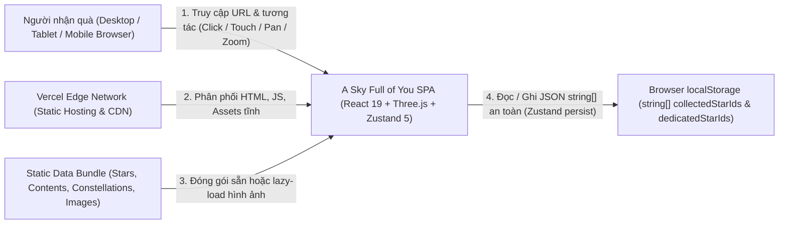
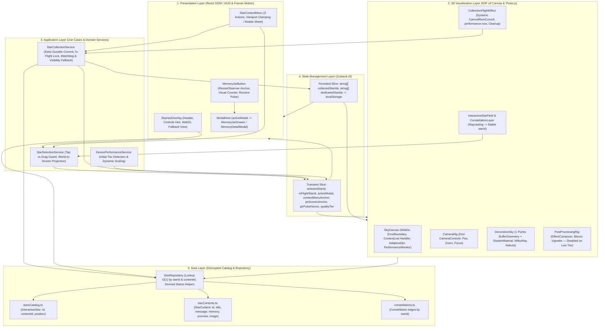
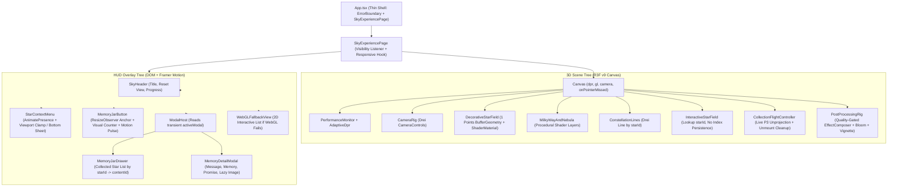
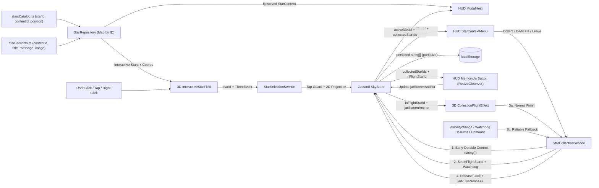
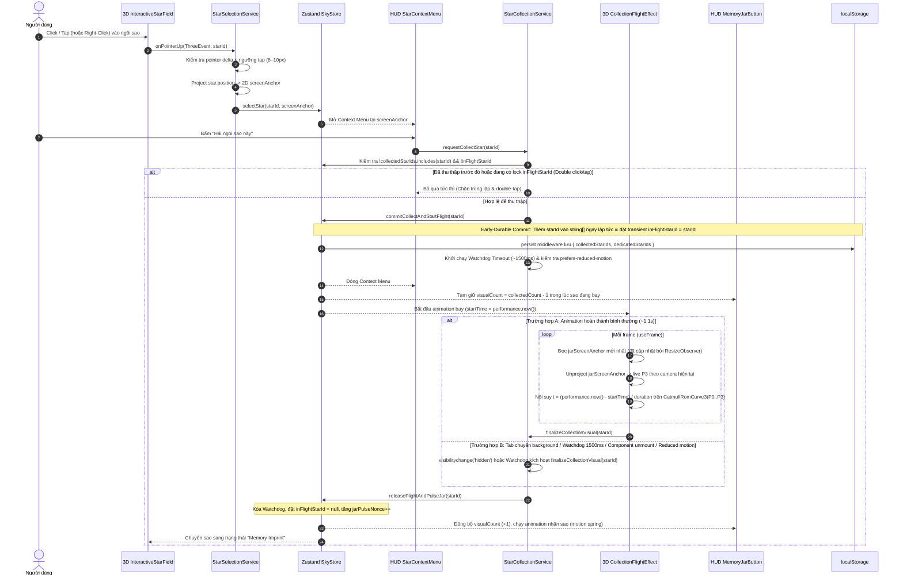
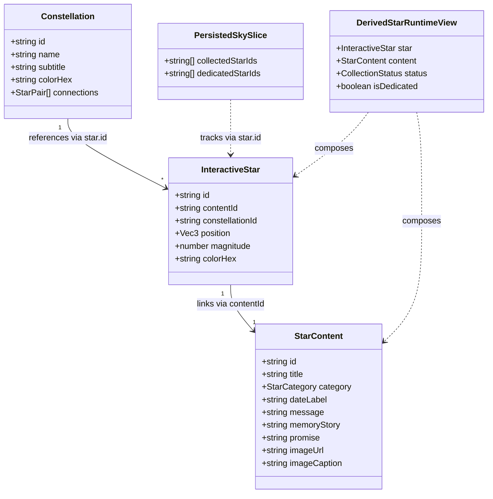

# ARCHITECTURE.md — A Sky Full of You

> **Phiên bản tài liệu:** 1.1 (High-Level Design — Updated per Architecture Review `TD-08` – `TD-11`)  
> **Trạng thái:** Đã cập nhật theo Architecture Review, chờ phê duyệt cuối cùng trước khi triển khai source code  
> **Phạm vi:** V1 — Personal Romantic Gift Web Application (Frontend-only, Static Hosting trên Vercel)

---

## 1. Project Overview

**A Sky Full of You** là một website quà tặng tình yêu mang trải nghiệm tương tác với bầu trời vũ trụ 3D theo thời gian thực, lấy cảm hứng từ bản đồ sao thiên văn **Stellarium**. Thay vì hiển thị lời chúc hoặc album ảnh theo dạng trang web tĩnh truyền thống, người dùng (người nhận quà) được đắm mình vào một dải ngân hà lung linh với hàng nghìn ngôi sao, tinh vân, và các chòm sao mang dấu ấn kỷ niệm riêng.

Người dùng có thể tự do khám phá bầu trời (pan, zoom, xoay nhẹ), chạm hoặc click vào những ngôi sao kỷ niệm đặc biệt, lựa chọn **"Hái ngôi sao này"**, **"Dành riêng cho em"**, hoặc **"Để lại trên bầu trời"**. Khi hái sao, ngôi sao bừng sáng và bay theo quỹ đạo đường cong mềm mại vào **Chiếc lọ Ký ức (Memory Jar)**, nơi lưu giữ trọn vẹn lời nhắn, kỷ niệm, lời hứa và hình ảnh gắn với từng vì sao.

### Mục tiêu cốt lõi của kiến trúc
1. **Trải nghiệm điện ảnh & mượt mà (60 FPS target):** Tách biệt hoàn toàn các ngôi sao trang trí (hàng nghìn điểm render trong 1 draw call GPU) khỏi các ngôi sao tương tác chứa nội dung.
2. **Tách biệt trách nhiệm theo 5 Layer:** Không dồn logic vào `App.tsx`, không hardcode dữ liệu nội dung sao trong component UI/3D, và tách biệt animation bay của sao khỏi tính toàn vẹn của nghiệp vụ thu thập/lưu trữ.
3. **Định danh ổn định & Lưu trữ an toàn (`TD-08`, `TD-09`):** Tách rời `Star ID`, `Content ID`, `Position`, và `Collection Status`; chỉ persist mảng `string[]` thuần túy qua Zustand `persist` để tránh sai lệch sau khi reload hoặc thay đổi thứ tự dữ liệu.
4. **Animation tin cậy trên mọi trạng thái trình duyệt (`TD-10`):** Quỹ đạo bay tự cập nhật theo camera/layout động, có cơ chế Early-Durable Commit kết hợp Watchdog Timeout và `visibilitychange` để không bao giờ mất dữ liệu hay kẹt lock.
5. **Đa thiết bị & Khóa tương thích dependency (`TD-11`):** Khóa phiên bản thư viện tương thích đã kiểm chứng peer dependencies (`React 19`, `R3F 9`, `Drei 10`, `Postprocessing 3`), có fallback cho thiết bị hiệu năng thấp và lỗi WebGL.

---

## 2. Functional Requirements

| Mã | Nhóm chức năng | Mô tả chi tiết |
| :--- | :--- | :--- |
| **FR-01** | **Galaxy Explorer** | Hiển thị bầu trời đêm gồm hàng nghìn ngôi sao trang trí lấp lánh, dải ngân hà (Milky Way band), tinh vân (nebula layers) nhiều lớp và các đường nối chòm sao kỷ niệm. Hỗ trợ pan, zoom, xoay mượt mà như bản đồ thiên văn. |
| **FR-02** | **Star Selection** | Phân biệt sao tương tác với sao nền. Khi người dùng click (desktop) hoặc tap (mobile) — hoặc click chuột phải (optional trên desktop) — vào một sao tương tác, ngôi sao phát sáng nổi bật và mở Context Menu với 3 lựa chọn: *"Hái ngôi sao này"*, *"Dành riêng cho em"*, *"Để lại trên bầu trời"*. |
| **FR-03** | **Star Dedication** | Khi chọn *"Dành riêng cho em"*, ngôi sao được gắn trạng thái ưu tiên/đánh dấu đặc biệt (aura màu vàng hồng/rose-gold nổi bật trên bầu trời và huy hiệu riêng trong Memory Jar). Cho phép bật/tắt trạng thái này mà không cần hái sao. |
| **FR-04** | **Leave Star in Sky** | Khi chọn *"Để lại trên bầu trời"*, context menu đóng lại, ngôi sao trở về trạng thái bình thường trên bầu trời, không bị thu thập. |
| **FR-05** | **Star Collection & Flight** | Khi chọn *"Hái ngôi sao này"*, hệ thống kiểm tra tính hợp lệ (chưa từng thu thập, không trùng thao tác), commit an toàn ID sao vào store, khóa lock `inFlightStarId`, và kích hoạt hiệu ứng sao bừng sáng bay theo đường cong 3D (`CatmullRomCurve3`) về vị trí hiện tại của Chiếc lọ Ký ức. |
| **FR-06** | **Memory Jar & Counter** | Chiếc lọ Ký ức hiển thị bộ đếm tiến độ (`visualCollectedCount / totalInteractiveStars`), phát animation rung/tỏa sáng khi sao chạm lọ. Mở Chiếc lọ để xem danh sách các ngôi sao đã hái và mở đọc từng ngôi sao (lời nhắn, kỷ niệm, lời hứa, hình ảnh). |
| **FR-07** | **Duplicate Prevention** | Ngăn chặn tuyệt đối việc thu thập trùng `starId` ở cả tầng nghiệp vụ, tầng trạng thái (deduplication `string[]` trước khi lưu) và UI (sao đã thu thập hiển thị trạng thái *"Đã lưu trong lọ — Mở kỷ niệm"* thay vì cho phép hái lại). |
| **FR-08** | **State Persistence** | Lưu trữ danh sách `collectedStarIds: string[]` và `dedicatedStarIds: string[]` xuống `localStorage` thông qua Zustand `persist` để giữ nguyên tiến độ sau khi tải lại trang. |
| **FR-09** | **Adaptive Quality & Fallbacks** | Tự nhận diện thiết bị, điều chỉnh mật độ hạt, DPR và tắt `EffectComposer`/`Bloom` trên thiết bị yếu (`low` tier). Cung cấp fallback 2D nếu WebGL mất context hoặc không khả dụng. |

---

## 3. Non-functional Requirements

| Nhóm | Yêu cầu cụ thể | Chỉ tiêu thiết kế |
| :--- | :--- | :--- |
| **Performance** | Tốc độ khung hình mượt mà trên cả desktop và mobile tầm trung. | 55–60 FPS trên Desktop, ≥ 30–60 FPS ổn định trên Mobile; Decorative stars = 1 draw call; Zero React re-render trong `useFrame`. |
| **Responsiveness & Touch UX** | Dễ thao tác bằng ngón tay, không chọn nhầm sao khi đang kéo camera, đồng bộ anchor khi xoay màn hình. | Ngưỡng phân biệt tap vs drag (`< 6–10px`); `ResizeObserver` cập nhật `jarScreenAnchor`; Context Menu tự kẹp viewport hoặc dùng Bottom Sheet trên mobile. |
| **Reliability & Data Integrity** | Không sai lệch trạng thái sau reload; không mất dữ liệu hoặc kẹt lock khi animation gián đoạn / chuyển tab. | Persist chỉ dùng `string[]` (không dùng `Set`); Early-Durable Commit + Watchdog timeout + `visibilitychange` cleanup; `localStorage` validate qua `StarRepository` khi rehydrate. |
| **Maintainability** | Thay đổi thứ tự mảng sao/nội dung không ảnh hưởng trạng thái đã hái. | Tách biệt `InteractiveStar` (`starId`, `contentId`, `position`) khỏi `StarContent` và `CollectionStatus`. |
| **Bundle & Load Time** | Tải nhanh lần đầu trên mạng di động 4G. | Code-splitting modal/drawer; ảnh kỷ niệm tải lười (`loading="lazy"`) khi mở từng ngôi sao. |
| **Accessibility & Fallback** | Hỗ trợ chuyển động giảm nhẹ và xử lý lỗi WebGL. | Tôn trọng `prefers-reduced-motion` (tắt bay dài, commit tức thì); có `WebGLFallbackView` để luôn đọc được kỷ niệm. |

---

## 4. System Context Diagram

Kiến trúc V1 là ứng dụng Single-Page Application (SPA) chạy hoàn toàn trên trình duyệt của người dùng, phân phối qua CDN của Vercel. Không có Backend Server hay Database Server.



---

## 5. High-Level Architecture Diagram

Hệ thống được tổ chức theo **5 Layer** tách biệt rõ trách nhiệm, phụ thuộc một chiều và tách biệt render loop 3D khỏi tính bền vững của nghiệp vụ lưu trữ.



### Trách nhiệm từng Layer

1. **Presentation Layer (`src/components/hud/`):**
   - Hiển thị HUD, Context Menu, `MemoryJarButton` (gắn `ResizeObserver` cập nhật tọa độ neo cho đường bay), và `ModalHost` điều khiển qua `activeModal`.
   - Dùng `motion` và `AnimatePresence` từ `framer-motion` (`14.12.0`).
   - **Không chứa** logic Three.js, không tự đọc `localStorage`, không gắn cứng dữ liệu sao.

2. **3D Visualization Layer (`src/components/sky/`):**
   - Quản lý `<Canvas>`, `CameraControls`, `ShaderMaterial`, sao tương tác, quỹ đạo bay `CatmullRomCurve3`, và hậu kỳ (`EffectComposer`).
   - Toàn bộ chuyển động theo frame chạy trong `useFrame` (dùng `performance.now()` cho tiến độ bay để chống trôi khi throttle) — **tuyệt đối không gọi `setState` mỗi frame**.
   - `InteractiveStarField` ánh xạ hit target về **`starId` bất biến** (không truyền array index ra nghiệp vụ).

3. **Application Layer (`src/services/`, `src/hooks/`):**
   - `StarSelectionService`: Lọc tap vs drag (`pointerDown -> pointerUp`), project 3D → 2D.
   - `StarCollectionService`: Điều phối quy trình thu thập **an toàn độc lập với animation**:
     - Kiểm tra trùng ID, kích hoạt **Early-Durable Commit** ngay khi hợp lệ, khóa `inFlightStarId`, thiết lập **Watchdog Timeout (`1500ms`)** và lắng nghe **`visibilitychange`** (khi tab bị đưa xuống background) để luôn hoàn tất cleanup & giải phóng lock.
   - `DevicePerformanceService`: Phát hiện thiết bị yếu để tắt postprocessing và hạ mật độ hạt ngay từ đầu.

4. **State Management Layer (`src/store/`):**
   - Sử dụng Zustand `5.1.0` (`create`, `persist`, `createJSONStorage`).
   - Tuân thủ tuyệt đối `TD-08`: **chỉ lưu `string[]`** trong persistent state (`collectedStarIds`, `dedicatedStarIds`), loại bỏ toàn bộ transient state (`selectedStarId`, `inFlightStarId`, `activeModal`, v.v.) qua `partialize`, và kiểm tra tính hợp lệ khi rehydrate.

5. **Data Layer (`src/data/`, `src/repositories/`):**
   - Tuân thủ tuyệt đối `TD-09`: Tách rời bảng sao (`starsCatalog.ts` — chứa `id`, `contentId`, `position`) khỏi bảng nội dung (`starContents.ts` — chứa lời nhắn, kỷ niệm, lời hứa, ảnh) và bảng chòm sao (`constellations.ts`).
   - `StarRepository` lập chỉ mục bằng `Map<string, ...>` ở module init để truy xuất `O(1)` theo ID, bất biến với thứ tự mảng.

---

## 6. Component Architecture



### Phân biệt Sao Trang Trí vs Sao Tương Tác

| Tiêu chí | Sao trang trí (`DecorativeStarField`) | Sao tương tác (`InteractiveStarField`) |
| :--- | :--- | :--- |
| **Số lượng** | 1.500 – 7.500 sao (tùy `qualityTier`) | 15 – 50 sao kỷ niệm được tuyển chọn |
| **Cách render** | **1 React component duy nhất** tạo 1 `THREE.Points` với `BufferGeometry` + `BufferAttribute` (`position`, `aSize`, `aColor`, `aPhase`) | Nhóm render nhẹ gồm glowing shader points + halo aura + hit target gắn định danh `starId` trực tiếp |
| **Raycasting** | **Tắt hoàn toàn** (`raycast={() => null}`) để không tốn CPU | **Bật raycasting** với ngưỡng mở rộng cho touch; trả về `starId` bất biến (không dùng `index` làm ID) |
| **Dữ liệu nội dung** | Không có ID, không có memory, sinh bằng deterministic PRNG | Có `star.id` cố định liên kết `contentId` → `StarContent`, tọa độ `position` độc lập |
| **Trạng thái thu thập** | Không có trạng thái thu thập | Suy xuất runtime từ Store: `available` / `collecting` (khi `inFlightStarId === star.id`) / `collected` (+ `isDedicated`) |

---

## 7. Data Flow Diagram



---

## 8. Star Collection Sequence Diagram (Revised — `TD-10`)

Sơ đồ dưới đây thể hiện luồng thu thập **an toàn và đáng tin cậy**, tách biệt **Early-Durable Commit** (bảo toàn dữ liệu ngay lập tức) khỏi **Visual Flight Animation** (hiệu ứng bay 3D động theo camera & layout, có fallback Watchdog + `visibilitychange` + Unmount cleanup).



### Điểm nổi bật của luồng mới (`TD-10`)
1. **Không mất sao khi tắt/reload giữa chừng:** Ngay khoảnh khắc bấm *"Hái ngôi sao này"*, `starId` được commit vào `collectedStarIds` (`string[]`) và đồng bộ xuống `localStorage`. Animation chỉ đóng vai trò trình diễn thị giác (`inFlightStarId` làm nhiệm vụ giữ visual count thêm ~1.1s cho cảm giác sao bay vào lọ rồi mới nảy số).
2. **An toàn với Camera & Responsive Layout:** Trong từng `useFrame`, `CollectionFlightEffect` luôn đọc tọa độ `jarScreenAnchor` mới nhất (do `ResizeObserver` trên `MemoryJarButton` cập nhật) và unproject bằng `camera` hiện hành thành `P3`, nên dù người dùng xoay/zoom camera hoặc xoay màn hình điện thoại giữa lúc bay, đường cong `CatmullRomCurve3` vẫn hướng đúng vào chiếc lọ.
3. **Miễn nhiễm Double-Click / Double-Tap & Treo Lock:** Khóa `inFlightStarId` set đồng bộ trước frame render, cộng thêm Watchdog `1500ms` + `visibilitychange` + unmount cleanup đảm bảo `inFlightStarId` luôn về `null`.

---

## 9. State Management Design (`TD-08`)

Sử dụng **Zustand `5.1.0`** với curried syntax `create<SkyStore>()(...)`, middleware `persist` và `createJSONStorage(() => localStorage)`.

### Nguyên tắc bắt buộc về Kiểu dữ liệu & Persistence (`TD-08`)
1. **Chỉ dùng `string[]` cho danh sách ID trong Store** (`collectedStarIds: string[]`, `dedicatedStarIds: string[]`). **Tuyệt đối không** lưu `Set` trong Zustand state vì `JSON.stringify(new Set(...))` trả về `"{}"`, dẫn đến mất toàn bộ sao đã hái sau khi reload.
   - Khi component/service cần tra cứu `O(1)`, sử dụng selector/hook `useMemo(() => new Set(collectedStarIds), [collectedStarIds])` ở tầng đọc.
2. **Tách biệt rạch ròi Persisted State vs Transient State** qua `partialize`.

### Bảng chi tiết State Schema

| Nhóm State | Trường dữ liệu | Kiểu dữ liệu | Persist vào `localStorage`? | Giá trị mặc định sau reload |
| :--- | :--- | :--- | :--- | :--- |
| **Persisted** | `collectedStarIds` | `string[]` | **Có** | Khôi phục & sanitize từ `localStorage` |
| **Persisted** | `dedicatedStarIds` | `string[]` | **Có** | Khôi phục & sanitize từ `localStorage` |
| **Transient** | `selectedStarId` | `string \| null` | **Không** | `null` |
| **Transient** | `inFlightStarId` | `string \| null` | **Không** | `null` |
| **Transient** | `activeModal` | `ActiveModalState` | **Không** | `{ type: 'none' }` |
| **Transient** | `hoveredStarId` | `string \| null` | **Không** | `null` |
| **Transient** | `contextMenuAnchor` | `ScreenPoint \| null` | **Không** | `null` |
| **Transient** | `jarScreenAnchor` | `ScreenPoint` | **Không** | `{ x: window.innerWidth - 56, y: window.innerHeight - 56 }` *(cập nhật ngay bởi `ResizeObserver`)* |
| **Transient** | `jarPulseNonce` | `number` | **Không** | `0` |
| **Transient** | `qualityTier` | `'low' \| 'medium' \| 'high'` | **Không** | Kết quả từ `DevicePerformanceService` |

### TypeScript Definitions & Cấu hình `persist` An toàn

```ts
export type ActiveModalState =
  | { type: 'none' }
  | { type: 'jar' }
  | { type: 'memory'; starId: string };

export interface PersistedSkySlice {
  collectedStarIds: string[];
  dedicatedStarIds: string[];
}

export interface TransientSkySlice {
  selectedStarId: string | null;
  inFlightStarId: string | null;
  activeModal: ActiveModalState;
  hoveredStarId: string | null;
  contextMenuAnchor: { x: number; y: number } | null;
  jarScreenAnchor: { x: number; y: number };
  jarPulseNonce: number;
  qualityTier: 'low' | 'medium' | 'high';
}
```

### Cơ chế chống sai lệch trạng thái sau Reload
- **`partialize`:** Chỉ trả về `{ collectedStarIds: state.collectedStarIds, dedicatedStarIds: state.dedicatedStarIds }`.
- **`version: 1` & `migrate`:** Chuẩn bị sẵn đường nâng cấp schema nếu đổi cấu trúc ở V2.
- **Sanitization trong `merge` / `onRehydrateStorage`:**
  1. Kiểm tra an toàn kiểu mảng (`Array.isArray(persisted?.collectedStarIds)`), fallback về `[]` nếu JSON bị hỏng hoặc bị chỉnh sửa tay thành kiểu khác.
  2. Lọc bỏ ID mồ côi (`StarRepository.hasStar(id)`) và loại bỏ trùng lặp (`Array.from(new Set(...))`) để đảm bảo kết quả cuối cùng luôn là `string[]` hợp lệ, không trùng.
  3. Ghép với `currentState` sao cho mọi transient field (`selectedStarId`, `inFlightStarId`, `activeModal`, `contextMenuAnchor`) luôn giữ nguyên giá trị sạch ban đầu.

---

## 10. Data Model (`TD-09`)

### Sơ đồ quan hệ dữ liệu tách biệt (Mermaid Class Diagram)



### Nguyên tắc tách biệt 4 thực thể độc lập (`TD-09`)

1. **Star ID (`InteractiveStar.id`):** Định danh bất biến (ví dụ: `'star-first-rain'`). **Không bao giờ** dùng chỉ số mảng (`0, 1, 2...`) hay `ThreeEvent.index` của `BufferGeometry` làm ID bền vững.
2. **Content ID (`StarContent.id`):** Định danh bất biến của nội dung kỷ niệm (ví dụ: `'content-first-rain'`), lưu trong dictionary/catalog riêng (`starContents.ts`). Cho phép chỉnh sửa, sắp xếp lại danh sách sao hoặc gán lại nội dung qua `contentId` mà không phá vỡ định danh sao.
3. **Position (`InteractiveStar.position`):** Tọa độ 3D `[x, y, z]` độc lập hoàn toàn với nội dung văn bản/ảnh và độc lập với trạng thái đã thu thập.
4. **Collection Status (`CollectionStatus`):** Không tồn tại trong file dữ liệu tĩnh; được tính toán động tại runtime:
   - `inFlightStarId === star.id` → `'collecting'`
   - `collectedSet.has(star.id)` → `'collected'`
   - Ngược lại → `'available'`

### Core TypeScript Interfaces

```ts
export type StarCategory = 'message' | 'memory' | 'promise' | 'gallery';
export type CollectionStatus = 'available' | 'collecting' | 'collected';

/** Tách riêng nội dung kỷ niệm, định danh bằng content.id */
export interface StarContent {
  id: string;               // VD: "content-first-rain"
  title: string;            // Tên hiển thị của kỷ niệm / ngôi sao
  category: StarCategory;
  dateLabel?: string;       // VD: "14/02/2025"
  message: string;          // Lời nhắn chính
  memoryStory?: string;     // Câu chuyện kỷ niệm chi tiết
  promise?: string;         // Lời hứa gắn với ngôi sao
  imageUrl?: string;        // Đường dẫn ảnh trong public/memories/
  imageCaption?: string;
}

/** Tách riêng ngôi sao trên bầu trời 3D, định danh bằng star.id */
export interface InteractiveStar {
  id: string;               // Định danh cố định, bất biến (VD: "star-first-rain")
  contentId: string;        // Tham chiếu sang StarContent.id
  constellationId?: string; // Thuộc chòm sao nào (nếu có)
  position: [number, number, number];
  magnitude: number;        // Độ sáng tương đối (0.8 -> 2.0)
  colorHex: string;         // Màu sắc thiên văn (#fff3d1, #ffd6e0, ...)
}

export interface Constellation {
  id: string;
  name: string;
  subtitle?: string;
  colorHex: string;
  /** Cặp tham chiếu trực tiếp bằng Star ID cố định (không dùng array index) */
  connections: Array<[string, string]>;
}
```

> **Đảm bảo khi thay đổi thứ tự dữ liệu:** Khi khởi tạo, `StarRepository` build `Map<string, InteractiveStar>` và `Map<string, StarContent>` theo `.id`. Nếu lập trình viên đảo thứ tự phần tử trong `starsCatalog.ts` hoặc `starContents.ts`, mọi `starId` ↔ `contentId` ↔ `collectedStarIds` trong `localStorage` vẫn khớp chính xác 100%.

---

## 11. Folder Structure

Cấu trúc thư mục theo kiến trúc 5 Layer, tối ưu cho Vite + React + TypeScript:

```text
star/
├── ARCHITECTURE.md                     # Tài liệu kiến trúc tổng thể (HLD)
├── index.html                          # Entry HTML, meta viewport & font thiên văn
├── package.json                        # Locked dependency versions (TD-11)
├── tsconfig.json
├── vite.config.ts
├── public/
│   └── memories/                       # Ảnh kỷ niệm (WebP/AVIF, lazy-load)
└── src/
    ├── main.tsx                        # React mount point
    ├── App.tsx                         # Thin root shell (ErrorBoundary + SkyExperiencePage)
    ├── pages/
    │   └── SkyExperiencePage.tsx       # Phối hợp 3D Canvas, HUD, Visibility/Watchdog hooks
    │
    ├── data/                           # [DATA LAYER] Dữ liệu tách biệt theo TD-09
    │   ├── starsCatalog.ts             # Mảng InteractiveStar (id, contentId, position)
    │   ├── starContents.ts             # Mảng StarContent (id, title, message, image)
    │   ├── constellations.ts           # Định nghĩa chòm sao & cặp [starIdA, starIdB]
    │   └── qualityProfiles.ts          # Cấu hình mật độ hạt cho low/medium/high
    │
    ├── repositories/                   # [DATA LAYER] Adapter truy xuất O(1) theo ID
    │   └── starRepository.ts           # Map<starId>, Map<contentId>, deriveStatus()
    │
    ├── types/                          # Shared TypeScript Domain Types
    │   ├── star.ts
    │   ├── store.ts
    │   └── performance.ts
    │
    ├── store/                          # [STATE LAYER] Zustand v5
    │   └── useSkyStore.ts              # create + persist (string[] only) + partialize + merge sanitize
    │
    ├── services/                       # [APPLICATION LAYER] Nghiệp vụ thuần
    │   ├── starSelectionService.ts     # Tap-vs-drag guard, 3D->2D projection, clamping
    │   ├── starCollectionService.ts    # Early-Durable Commit, inFlight lock, Watchdog + Visibility
    │   └── devicePerfService.ts        # Nhận diện cấu hình phần cứng ban đầu
    │
    ├── hooks/                          # [APPLICATION LAYER] React adapter hooks
    │   ├── useCollectionReliability.ts # Lắng nghe visibilitychange & dọn dẹp timer khi unmount
    │   ├── useResponsiveLayout.ts      # Breakpoint + isTouchDevice + prefers-reduced-motion
    │   └── useDerivedStarLists.ts      # Memoized Set lookup từ string[] store
    │
    ├── components/
    │   ├── sky/                        # [3D VISUALIZATION LAYER] R3F v9 & Three.js
    │   │   ├── SkyCanvas.tsx           # <Canvas>, ContextLost listener, AdaptiveDpr, PerformanceMonitor
    │   │   ├── CameraRig.tsx           # <CameraControls> pan/zoom/focus & limits
    │   │   ├── DecorativeStarField.tsx # 1 BufferGeometry + ShaderMaterial (nghìn sao)
    │   │   ├── MilkyWayNebula.tsx      # Tinh vân & dải ngân hà mềm mại
    │   │   ├── ConstellationLayer.tsx  # Drei <Line> nối các sao theo starId
    │   │   ├── InteractiveStarField.tsx# Render + raycast riêng, trả về starId cố định
    │   │   ├── CollectionFlightEffect.tsx # Dynamic CatmullRomCurve3 (live jarScreenAnchor)
    │   │   ├── PostProcessingRig.tsx   # Quality-gated EffectComposer + Bloom + Vignette
    │   │   └── shaders/                # GLSL vertex & fragment shaders tách riêng
    │   │       ├── starField.glsl.ts
    │   │       └── nebula.glsl.ts
    │   │
    │   └── hud/                        # [PRESENTATION LAYER] UI 2D + Framer Motion
    │       ├── SkyHeader.tsx           # Tiêu đề, nút Reset góc nhìn, hướng dẫn
    │       ├── StarContextMenu.tsx     # Menu 3 lựa chọn (Desktop floating / Mobile sheet)
    │       ├── MemoryJarButton.tsx     # ResizeObserver anchor + visual count + pulse animation
    │       ├── ModalHost.tsx           # Render có điều kiện dựa trên activeModal
    │       ├── MemoryJarDrawer.tsx     # Danh sách sao đã hái
    │       ├── MemoryDetailModal.tsx   # Chi tiết lời nhắn, kỷ niệm, lời hứa, ảnh lazy-load
    │       └── WebGLFallbackView.tsx   # Giao diện 2D dự phòng nếu thiết bị lỗi WebGL
    │
    └── utils/
        ├── prng.ts                     # Deterministic seeded random cho sao nền
        └── math3d.ts                   # Vector3 curve control points & screen clamping
```

---

## 12. Technology Stack và lý do lựa chọn (`TD-11`)

### Bảng khóa phiên bản & Kiểm chứng Peer Dependencies (Verified Registry Matrix)

| Package | Phiên bản khóa (`package.json`) | Peer Dependencies thực tế đã kiểm chứng | Phân loại |
| :--- | :--- | :--- | :--- |
| `react` | `19.3.1` | — | **Bắt buộc (Core)** |
| `react-dom` | `19.3.1` | `react: ^19.3.1` | **Bắt buộc (Core)** |
| `three` | `0.187.0` *(khóa `<0.188.0`)* | — *(phải `<0.188.0` cho `postprocessing`)* | **Bắt buộc (Core)** |
| `@types/three` | `0.187.0` | `{}` *(khớp 1:1 với `three@0.187.0`)* | **Bắt buộc (Dev)** |
| `@react-three/fiber` | `9.8.2` | `react: >=19 <19.4`, `react-dom: >=19 <19.4`, `three: >=0.156` *(thỏa `>=9.7.0` của postprocessing)* | **Bắt buộc (Core)** |
| `@react-three/drei` | `10.7.9` | `react: ^19`, `react-dom: ^19`, `three: >=0.159`, `@react-three/fiber: ^9.0.0` | **Khuyến nghị mạnh** |
| `@react-three/postprocessing` | `3.2.2` | `react: ^19.0.0`, `three: >=0.156.0`, `postprocessing: ^6.36.0`, `@react-three/fiber: >=9.7.0` | **Tùy chọn / Có điều kiện** |
| `postprocessing` | `6.39.6` | `three: >=0.168.0 <0.188.0` | **Tùy chọn / Có điều kiện** |
| `zustand` | `5.1.0` | `react: >=18.0.0`, `use-sync-external-store: >=1.2.0` | **Bắt buộc (Core)** |
| `framer-motion` | `14.12.0` | `react: ^18.0.0 || ^19.0.0`, `react-dom: ^18.0.0 || ^19.0.0` | **Khuyến nghị mạnh** |
| `vite` | `8.3.7` | — | **Bắt buộc (Dev)** |
| `@vitejs/plugin-react` | `6.3.0` | `vite: ^8.0.0` | **Bắt buộc (Dev)** |
| `typescript` | `5.9.3` | — *(ổn định với toàn bộ `@types/*` của hệ sinh thái R3F)* | **Bắt buộc (Dev)** |
| `@types/react` / `@types/react-dom` | `19.3.0` | — | **Bắt buộc (Dev)** |

> **Phân tích kiểm chứng Tương thích (`TD-11`):**
> 1. **Tại sao phải khóa `@react-three/fiber@9.8.2` thay vì `9.0.0` hay `10.x`?**
>    - `@react-three/postprocessing@3.2.2` yêu cầu `@react-three/fiber >= 9.7.0`, nên các bản 9.0–9.6 sẽ gây xung đột peer dependency.
>    - `@react-three/fiber` v10 hiện mới ở kênh `alpha`/`canary` (`10.0.0-alpha.6`) và chuyển sang WebGPU mặc định, chưa phù hợp làm nền tảng production với `ShaderMaterial` GLSL và `@react-three/postprocessing`.
>    - `react@19.3.1` thỏa điều kiện `>=19 <19.4` của `R3F 9.8.2`.
> 2. **Tại sao phải khóa `three@0.187.0`?**
>    - `postprocessing@6.39.6` có peer dependency chặt `three: >= 0.168.0 < 0.188.0`. Việc khóa chính xác `0.187.0` ngăn không cho `npm install` trong tương lai tự kéo `0.188.0` gây lỗi `ERESOLVE` hoặc API mismatch.
> 3. **Kiểm tra `framer-motion@14.12.0`:**
>    - Phiên bản `14.12.0` hỗ trợ chính thức `React 19` (`^18.0.0 || ^19.0.0`), đảm bảo `motion` và `AnimatePresence` hoạt động không lỗi StrictMode hay ref cleanup.

---

### Chi tiết API & Kiểm chứng kỹ thuật Shader / Postprocessing

#### A. Custom `ShaderMaterial` + `Bloom` + `EffectComposer` trên `three@0.187.0`
- **Vấn đề Tone Mapping khi kết hợp Selective Bloom:** Trên Three.js `0.18x`, renderer áp dụng tone mapping mặc định có thể clamp màu RGB về `[0, 1]`, làm mất ngưỡng sáng kích hoạt `<Bloom luminanceThreshold={0.95} />`.
- **Cách cấu hình chuẩn:**
  - Đặt **`toneMapped={false}`** trên `ShaderMaterial` của các ngôi sao tương tác / sao đang bay và xuất giá trị HDR (`gl_FragColor = vec4(color * hdrBoost, alpha)` với `hdrBoost` từ `1.6` đến `3.2` khi hover/select/fly).
  - Trong `<EffectComposer enableNormalPass={false} multisampling={0}>`:
    - `enableNormalPass={false}` tránh tạo render target normal buffer tốn băng thông.
    - `multisampling={0}` tránh lỗi WebGL framebuffer MSAA trên một số GPU mobile và giảm chi phí render.
    - `<Bloom mipmapBlur luminanceThreshold={0.95} luminanceSmoothing={0.05} intensity={0.85} />`: dùng thuật toán Dual-Kawase `mipmapBlur` của `postprocessing@6.39.6` cho quầng sáng mượt, nhẹ.
    - `<Vignette offset={0.35} darkness={0.45} />`: tạo chiều sâu khung hình thiên văn.
- **Fallback trên thiết bị hiệu năng thấp (`qualityTier === 'low'`):**
  - **Không mount `<EffectComposer>`** trên `low` tier.
  - Chính fragment shader của `DecorativeStarField` và `InteractiveStarField` sẽ tự tính quầng sáng mềm (`smoothstep` radial falloff + additive blending `THREE.AdditiveBlending`) nên bầu trời vẫn lung linh mà không tốn bất kỳ pass postprocessing nào.

#### B. React Three Fiber (`@react-three/fiber@9.8.2`)
- `<Canvas>`: Khởi tạo WebGL context một lần, gắn handler `webglcontextlost` / `webglcontextrestored` trên `gl.domElement` trong `onCreated`.
- `useFrame((state, delta) => ...)`: Cập nhật `uTime` trong shader và tiến độ đường bay bằng **`performance.now()`** (không dựa vào tích lũy `delta` để tránh đứng/nhảy khi tab bị throttle).
- `useThree()`: Truy xuất `camera`, `size`, `raycaster` để thực hiện `Vector3.project(camera)` / `Vector3.unproject(camera)` và cân chỉnh `raycaster.params.Points.threshold`.
- Pointer Events (`ThreeEvent<PointerEvent>`): Gắn `onPointerDown`, `onPointerUp`, `onContextMenu`, `onPointerOver`, `onPointerOut` lên hit targets của `InteractiveStarField`.

#### C. Three.js (`three@0.187.0`)
- `BufferGeometry`, `BufferAttribute`, `Points`, `ShaderMaterial`: Gộp toàn bộ sao trang trí vào **1 draw call**.
- `Raycaster`: Tắt trên `DecorativeStarField`, bật trên `InteractiveStarField`.
- `CatmullRomCurve3`, `Vector3`: Tính đường bay cong mượt mà với `P3` cập nhật động theo camera & layout mỗi frame.

#### D. Drei (`@react-three/drei@10.7.9`)
- **`CameraControls` (chọn thay `MapControls`):** Hỗ trợ đầy đủ pan (`truck`), zoom (`dolly`), xoay nhẹ bầu trời, damping, cảm ứng đa điểm và chuyển góc nhìn mượt bằng code (`setLookAt`, `reset`).
- **`Line`:** Vẽ các đường nối chòm sao bằng cặp `[starIdA, starIdB]`.
- **`PerformanceMonitor` + `AdaptiveDpr`:** Tự động hạ DPR và chuyển bậc `qualityTier` khi FPS giảm.
- **`Stars` (Tùy chọn):** Không dùng vì `DecorativeStarField` tùy biến theo hình thái dải ngân hà và `qualityTier` hiệu quả hơn.

#### E. Framer Motion (`framer-motion@14.12.0`) & Zustand (`zustand@5.1.0`)
- `motion`, `AnimatePresence`: Tạo chuyển động spring cho Memory Jar, Context Menu và Modal.
- `create`, `persist`, `createJSONStorage` (từ `'zustand/middleware'`): Lưu bền vững `string[]` vào `localStorage`.

---

## 13. Performance Strategy

1. **Batching tối đa:** 1.500–7.500 sao nền nằm trong **1 `THREE.Points` draw call**; không tạo component React cho từng sao trang trí.
2. **Zero-Allocation trong `useFrame`:** Tái sử dụng `Vector3` và biến tạm qua `useRef`/`useMemo`, tuyệt đối không gọi `setState` mỗi frame.
3. **2-Layer Quality Tiering & Low-End Fallback:**
   - **Tầng 1 (Khởi tạo - `DevicePerformanceService`):** Dựa vào `hardwareConcurrency`, `deviceMemory`, GPU/mobile heuristics:
     - `high`: 7.500 decorative stars, 4 nebula layers, DPR `[1, 2]`, `EffectComposer` (`Bloom` + `Vignette`) BẬT.
     - `medium`: 4.000 decorative stars, 2 nebula layers, DPR `[1, 1.5]`, `EffectComposer` BẬT.
     - `low`: 1.500 decorative stars, 1 nebula layer, DPR `[0.75, 1]`, **TẮT hoàn toàn `EffectComposer`**, dùng glow nội tại trong `ShaderMaterial`.
   - **Tầng 2 (Runtime):** `PerformanceMonitor` + `AdaptiveDpr` tự động giảm DPR hoặc hạ tier xuống `low` nếu FPS tụt liên tục.
4. **WebGL Context Loss & No-WebGL Fallback:** Nếu thiết bị chặn WebGL hoặc mất context không khôi phục được, `WebGLFallbackView` cho phép xem danh sách sao kỷ niệm và mở Memory Jar ở chế độ 2D.
5. **Lazy-load Assets & Code-splitting:** Ảnh kỷ niệm nén WebP (< 300KB), tải lười khi mở `MemoryDetailModal`.

---

## 14. Responsive Strategy

| Khía cạnh | Desktop (`≥ 1024px`) | Tablet (`640px – 1023px`) | Mobile (`< 640px`) |
| :--- | :--- | :--- | :--- |
| **Điều khiển Camera (`CameraControls`)** | Kéo chuột trái = Pan/Xoay; Cuộn chuột = Zoom; Chuột phải trên sao = Context Menu. | 1 ngón = Pan/Xoay; 2 ngón chụm/mở = Zoom. | 1 ngón = Pan/Xoay; 2 ngón chụm/mở = Pinch Zoom. |
| **Chọn sao & Tap vs Drag** | Ngưỡng tap `< 6px`; hiện cursor `pointer` khi hover. | Ngưỡng tap `< 8px`; vùng hit mở rộng `1.5x`. | Ngưỡng tap `< 10px`; vùng hit mở rộng `1.8x–2.0x`. |
| **Context Menu** | Floating menu neo cạnh sao, kẹp mép màn hình (`16px` padding). | Floating menu tự lật hướng tránh tràn mép. | **Bottom Action Sheet** phía dưới (hỗ trợ `env(safe-area-inset-bottom)`). |
| **Đồng bộ vị trí Memory Jar (`TD-10`)** | `ResizeObserver` theo dõi `MemoryJarButton` cập nhật `jarScreenAnchor`. | Tự cập nhật khi resize cửa sổ. | Tự cập nhật tức thì khi xoay ngang/dọc màn hình hoặc đổi thanh địa chỉ mobile (`visualViewport`). |
| **Memory Detail Modal** | Card `max-w-lg` giữa màn hình. | Card `max-w-md`. | Sheet bo tròn dễ cuộn 1 tay. |

---

## 15. Risks và Technical Decisions (ADRs)

### Đánh giá Phương án FE-Only (Không Backend, Không Database) cho V1

- **Ưu điểm:** Phù hợp tuyệt đối cho quà tặng cá nhân; $0 hạ tầng; tốc độ cực nhanh qua Vercel CDN; không cần đăng nhập gây gián đoạn cảm xúc.
- **Giới hạn đã nhận diện:**
  1. Không đồng bộ tiến độ giữa nhiều thiết bị qua `localStorage`.
  2. Xóa dữ liệu duyệt web hoặc mở Incognito sẽ reset Chiếc lọ Ký ức.
  3. Nội dung lời nhắn/ảnh nằm trong client bundle.
  4. Muốn cập nhật thêm kỷ niệm cần chỉnh sửa data catalog và redeploy lên Vercel.

---

### Bảng Quyết định Kiến trúc (Architecture Decision Records — `TD-01` đến `TD-11`)

| ID | Vấn đề / Rủi ro | Quyết định kiến trúc | Lý do & Cơ chế đảm bảo |
| :--- | :--- | :--- | :--- |
| **TD-01** | **R3F v10 chưa stable và chuyển sang WebGPU** | Khóa **`@react-three/fiber@9.8.2`** (WebGL) cùng `react@19.3.1` | Tương thích 100% với `postprocessing@6.39.6`, `@react-three/postprocessing@3.2.2`, GLSL `ShaderMaterial` và trình duyệt di động. |
| **TD-02** | **Kéo camera bị nhầm thành click chọn sao** | Bộ lọc khoảng cách `pointerDown -> pointerUp` (`< 6–10px`) trong `StarSelectionService` | Ngăn mở Context Menu ngoài ý muốn sau mỗi thao tác xoay/pan. |
| **TD-03** | **Khó chạm trúng sao nhỏ trên mobile** | Tắt raycast ở `DecorativeStarField`; mở rộng hit target cho `InteractiveStarField` theo thiết bị | Bấm chính xác bằng ngón tay mà không bị sao nền cản tia raycast. |
| **TD-04** | **Quỹ đạo bay lệch khi camera di chuyển hoặc đổi layout** | `ResizeObserver` cập nhật `jarScreenAnchor`; `CollectionFlightEffect` tính lại `P3 = unproject(camera)` mỗi frame | Ngôi sao luôn bay trúng miệng Chiếc lọ dù user đang xoay/zoom camera hay xoay màn hình giữa chừng. |
| **TD-05** | **Hiệu năng yếu trên điện thoại cũ** | 3 `qualityTier` + `PerformanceMonitor` + `AdaptiveDpr`; tắt `EffectComposer` ở tier `low` | Shader tự vẽ quầng sáng mềm thay thế Bloom khi ở tier `low`; có `WebGLFallbackView` nếu lỗi WebGL. |
| **TD-06** | **User bấm "Hái" 2 lần liên tiếp (Double click / Double tap)** | Set lock đồng bộ `inFlightStarId` trước frame render + kiểm tra `!collectedStarIds.includes(starId)` | Chặn tuyệt đối double-tap và thu thập trùng ID. |
| **TD-07** | **Xóa mất sao sau khi hái làm hỏng hình dạng chòm sao** | Chuyển sao đã hái sang trạng thái **"Memory Imprint"** (ánh sáng dịu giữ đỉnh nối chòm sao) | Giữ nguyên thẩm mỹ bản đồ sao Stellarium và cho phép xem nhanh lại kỷ niệm từ bầu trời. |
| **TD-08** | **Zustand `persist` với `Set` bị serialize thành `{}` làm mất dữ liệu** | Chỉ dùng **`string[]`** (`collectedStarIds`, `dedicatedStarIds`) trong Store; loại bỏ transient state (`selectedStarId`, `inFlightStarId`, `activeModal`) qua `partialize`; sanitize & deduplicate khi rehydrate | Bảo đảm khôi phục chính xác 100% trạng thái sau khi F5/reload; dùng `useMemo(() => new Set(...))` nếu cần tra cứu `O(1)`. |
| **TD-09** | **Dùng array index làm ID khiến đổi thứ tự dữ liệu làm sai nội dung sao** | Tách rời `InteractiveStar.id` (bất biến), `StarContent.id` (`contentId`), `position`, và `CollectionStatus` (derived runtime) | Đảo thứ tự mảng `starsCatalog` / `starContents` không ảnh hưởng tới nội dung hay danh sách sao đã thu thập trong `localStorage`. |
| **TD-10** | **Animation bay bị gián đoạn khi chuyển tab, unmount hoặc tụt FPS làm kẹt lock / mất dữ liệu** | Áp dụng **Early-Durable Commit** (lưu `collectedStarIds` ngay khi hợp lệ) + **Visual Staging** + **`performance.now()`** + **Watchdog Timeout (`1500ms`)** + **`visibilitychange`** + unmount cleanup | Dữ liệu kỷ niệm không bao giờ mất kể cả khi đóng tab giữa animation; khóa `inFlightStarId` luôn được giải phóng an toàn. |
| **TD-11** | **Xung đột peer dependencies & sai màu Bloom trên Three.js `0.18x`** | Khóa ma trận version đã kiểm chứng (`react@19.3.1`, `three@0.187.0`, `R3F@9.8.2`, `drei@10.7.9`, `postprocessing@6.39.6`, `@react-three/postprocessing@3.2.2`, `framer-motion@14.12.0`, `zustand@5.1.0`); đặt `toneMapped={false}` trên HDR `ShaderMaterial` | Không lỗi `ERESOLVE`; Selective Bloom (`luminanceThreshold: 0.95`) hoạt động chuẩn xác với `mipmapBlur` và `enableNormalPass={false}`. |
